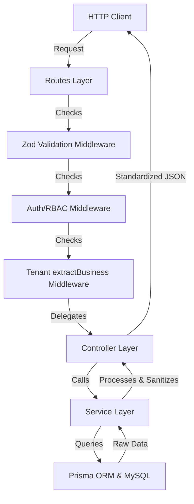

# Ryappar Application Architecture Documentation

This document describes the design patterns, code architecture, directory layout, and the logical data flow for all API endpoints in the Ryappar backend.

---

## 1. Architectural Pattern Overview

The application follows a modular, decoupled **Route-Middleware-Controller-Service** architecture. This pattern separates network interfaces, safety policies, business rules, and database operations.



### Responsibility Matrix

*   **Routes Layer (`src/routes`)**: Defines endpoint paths, HTTP verbs, and chains required middlewares (auth, validation, tenancy) in the correct sequence.
*   **Middlewares Layer (`src/middlewares`)**: 
    *   `validate`: Checks inputs (body, params, query) against Zod schemas.
    *   `authenticate`: Verifies JWT credentials and loads current user roles/permissions from DB.
    *   `extractBusiness`: Resolves target tenant (`businessId`) from `x-business-id` header (falling back to user's first business) and verifies user membership access.
*   **Controllers Layer (`src/controllers`)**: Extracts input parameters, catches async errors using `asyncHandler`, calls service methods, and sends standardized JSON responses using the `sendSuccess` helper.
*   **Services Layer (`src/services`)**: Contains the core business logic, transaction scopes (`prisma.$transaction`), stock deductions, banking receipts tracking, P&L calculations, and direct database queries.
*   **Database Client (`src/config/prisma.js`)**: Configures the connection pool using the `@prisma/adapter-mariadb` driver adapter.

---

## 2. Global Directory Structure

```
ryappar_backend/
├── prisma/
│   ├── migrations/               # SQL schema history files
│   └── schema.prisma             # Prisma Database models
├── seeder/
│   ├── seed.js                   # Seeding entry point
│   └── role-permission/
│       ├── rolePermission.data.js   # RBAC base seed data
│       └── rolePermission.seeder.js # RBAC seeder execution script
├── src/
│   ├── app.js                    # Express app configuration
│   ├── server.js                 # HTTP listener & lifecycle manager
│   ├── config/
│   │   ├── constants.js          # HTTP status codes & constants
│   │   ├── env.js                # Zod environment variable parsing
│   │   └── prisma.js             # PrismaClient & MariaDB Adapter setup
│   ├── controllers/
│   │   ├── auth.controller.js    # Register & Login controllers
│   │   ├── business.controller.js# Profile & Settings controllers
│   │   ├── party.controller.js   # Customers & Suppliers controllers
│   │   ├── inventory.controller.js# Products, Services, Categories, Units controllers
│   │   ├── sales.controller.js   # Invoices, Estimates, Payments controllers
│   │   ├── purchase.controller.js# Purchase invoices controllers
│   │   ├── banking.controller.js # Bank accounts & transfers controllers
│   │   ├── expense.controller.js # Expense entries controllers
│   │   ├── report.controller.js  # Dashboard, Growth & Reports controllers
│   │   ├── backup.controller.js  # DB snapshot export/restore controllers
│   │   └── user.controller.js    # Profile retrieval controller
│   ├── middlewares/
│   │   ├── authenticate.js       # JWT & DB RBAC extraction
│   │   ├── authorize.js          # requireRole & requirePermission guards
│   │   ├── extractBusiness.js    # Resolves tenant context (x-business-id)
│   │   ├── errorHandler.js       # Global Express error filter
│   │   ├── notFoundHandler.js    # Express route fallback handler
│   │   ├── rateLimiter.js        # IP rate limiting policies
│   │   └── validate.js           # Zod schema validation interceptor
│   ├── routes/
│   │   ├── index.js              # Combined API router root
│   │   ├── auth.routes.js        # Auth-only endpoints
│   │   ├── business.routes.js    # Company & Settings endpoints
│   │   ├── party.routes.js       # Customer/Supplier endpoints
│   │   ├── inventory.routes.js   # Item/Category/Unit endpoints
│   │   ├── sales.routes.js       # Invoices/Estimates/Receipts endpoints
│   │   ├── purchase.routes.js    # Purchase billing endpoints
│   │   ├── banking.routes.js     # Bank account ledger endpoints
│   │   ├── expense.routes.js     # Business expense endpoints
│   │   ├── report.routes.js      # Reports, Daybook, ProfitLoss, Growth endpoints
│   │   ├── backup.routes.js      # Backup & Restore endpoints
│   │   └── user.routes.js        # User & RBAC-guarded endpoints
│   ├── services/
│   │   ├── auth.service.js       # Register/Login (automatic tenant initialization)
│   │   ├── business.service.js   # Profile metadata & numbering generator
│   │   ├── party.service.js      # Party statements & balances
│   │   ├── inventory.service.js  # Stock levels adjustments
│   │   ├── sales.service.js      # Transactional invoicing & FIFO allocations
│   │   ├── purchase.service.js   # Purchase invoicing & stock increments
│   │   ├── banking.service.js    # Cash balance registers
│   │   ├── expense.service.js    # Expense log entries
│   │   ├── report.service.js     # Daybooks, P&L, collection ratios aggregates
│   │   ├── backup.service.js     # Business snapshot serialization
│   │   └── user.service.js       # User detail querying service
│   ├── utils/
│   │   ├── ApiError.js           # Standardized API Error class
│   │   ├── asyncHandler.js       # Async wrapper to omit try/catch blocks
│   │   ├── jwt.js                # JWT signing & verifying utility
│   │   ├── logger.js             # Winston logging config
│   │   ├── password.js           # Bcrypt hashing & comparisons
│   │   ├── response.js           # Standardized success response helper
│   │   └── sanitize.js           # Data sanitizer wrapper
│   └── validators/
│       ├── auth.validator.js     # Zod register/login schema validator
│       ├── business.validator.js # Zod profile/settings schema validator
│       ├── party.validator.js    # Zod customer/supplier schema validator
│       ├── inventory.validator.js# Zod item/category/unit schema validator
│       ├── sales.validator.js    # Zod sales invoices/receipts validator
│       ├── purchase.validator.js # Zod purchase invoice validator
│       ├── banking.validator.js  # Zod bank account/transaction validator
│       └── expense.validator.js  # Zod expense validation validator
└── prisma.config.js              # Prisma CLI configuration
```

---

## 3. Detailed Request/Response Flow Diagrams

### Flow A: User Registration (`POST /api/v1/auth/register`)

```
 [Client]  ──( POST /api/v1/auth/register )──► [auth.routes.js]
                                                       │
                                                       ▼
                                               [validate.js]
                                               - Runs registerSchema (Zod)
                                               - Trims inputs & validates businessName
                                                       │
                                                       ▼ (On success)
                                               [auth.controller.js]
                                               - Calls register() in service
                                                       │
                                                       ▼
                                               [auth.service.js]
                                               - Checks email uniqueness in DB
                                               - Fetches default "USER" role
                                               - Hashes password using Bcrypt
                                               - Creates User & links UserRole in DB
                                               - Initializes default Business (businessName)
                                               - Creates BusinessMember linking User as OWNER
                                               - Signs JWT token with User ID
                                               - Formats roles/permissions arrays
                                               - Strips password via sanitize.js
                                                       │
                                                       ▼ (Returns result)
                                               [auth.controller.js]
                                               - Calls sendSuccess(res, 201)
                                                       │
  [Client]  ◄──( 201 Created JSON Response )───────────┘
```

---

### Flow B: Tenant-Scoped Sales Invoices (`POST /api/v1/invoices`)

```
 [Client]  ──( POST /api/v1/invoices )──► [sales.routes.js]
               - Headers: Authorization & x-business-id
                                              │
                                              ▼
                                      [authenticate.js]
                                      - Validates JWT & sets req.user
                                              │
                                              ▼
                                      [extractBusiness.js]
                                      - Verifies membership in x-business-id
                                      - Sets req.businessId
                                              │
                                              ▼
                                      [validate.js]
                                      - Checks invoice body structure & rows
                                              │
                                              ▼
                                      [sales.controller.js]
                                      - Delegates to salesService.createInvoice()
                                              │
                                              ▼
                                      [sales.service.js]
                                      - Starts database transaction
                                      - Auto-generates unique doc number
                                      - Creates SalesInvoice and rows records
                                      - Decrements Item stock quantities
                                      - Logs StockLedger OUT entries
                                      - Records PaymentIn receipt (if paid > 0)
                                      - Increments BankAccount balance (if bank selected)
                                      - Commits transaction
                                              │
                                              ▼ (Returns invoice)
                                      [sales.controller.js]
                                      - Calls sendSuccess(res, 201)
                                              │
 [Client]  ◄──( 201 Created JSON Response )──┘
```
