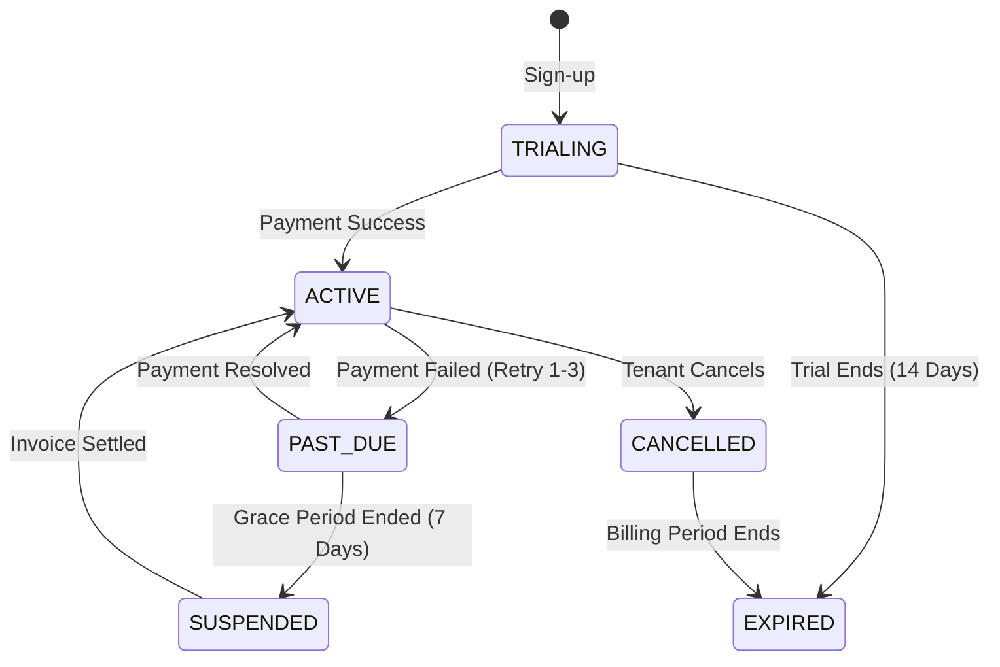

# NexBill — Master Architecture & Optimization Blueprint

> **Status**: Comprehensive Master Reference  
> **Target**: Multi-Tenant SaaS Transformation, Super Admin Platform, and Sub-50ms Billion-Row Scale  
> **Source Documents Synthesized**: `SAAS_IMPLEMENTATION_PLAN.md` + `DB_SCHEMA_AUDIT_AND_SCALE_PLAN.md` + Complete Codebase Deep Audit  
> **Generated**: October 2026  

---

## Executive Summary & Architectural Vision

Converting **NexBill** from a single-instance billing utility into an enterprise-grade multi-tenant SaaS platform capable of processing hundreds of millions to billions of transactions requires addressing issues across three interconnected layers:
1. **The Database & Scale Layer**: Eliminating table scan bottlenecks, missing indexes, unindexed foreign keys, God tables, lock contentions, and uncontrolled memory consumption.
2. **The Multi-Tenancy & Security Layer**: Enforcing strict tenant isolation, preventing cross-tenant document collisions, eliminating per-request 5-table authentication join queries, and establishing granular employee RBAC.
3. **The SaaS Infrastructure Layer**: Implementing an isolated Super Admin platform, automated subscription billing with webhook idempotency, hard quota enforcement, cursor-based pagination, and distributed object storage.

This document details the **optimal production-grade solutions** for all previously documented issues, reveals **8 critical newly discovered architectural flaws**, and outlines a **zero-downtime execution roadmap**.

---

## 🚨 Critical Newly Uncovered Issues (Not in Previous Plans)

Our deep codebase audit uncovered 8 severe bugs and architectural blockers that will crash the application as soon as multi-tenancy or high traffic is introduced:

### 1. Multi-Tenant Document Collision via Global `@unique` Constraints
- **The Bug**: In [schema.prisma](file:///c:/Users/HP/Desktop/nexbill/nexbill_backend/prisma/schema.prisma), every invoice, order, return, and payment document number has a global unique constraint:
  - `SalesInvoice.invoiceNo @unique`
  - `Estimate.estimateNo @unique`
  - `DeliveryChallan.challanNo @unique`
  - `SalesOrder.orderNo @unique`
  - `SalesReturn.returnNo @unique`
  - `PaymentIn.receiptNo @unique`
  - `PaymentOut.paymentNo @unique`
  - `PurchaseReturn.returnNo @unique`
  - `Expense.expenseNo @unique`
- **The Consequence**: As soon as Business B creates invoice `INV-001`, and Business A already has an `INV-001`, MariaDB throws `ERROR 1062: Duplicate entry`. No two businesses in the entire SaaS platform can share any document number.
- **The Fix**: Drop all global unique constraints and replace them with composite tenant-scoped constraints:
  ```prisma
  // BEFORE
  invoiceNo String @unique
  
  // AFTER
  invoiceNo String
  @@unique([businessId, invoiceNo])
  ```

---

### 2. Complete Absence of Pagination (Node.js Heap OOM & Frontend Freeze)
- **The Bug**: In [sales.service.js](file:///c:/Users/HP/Desktop/nexbill/nexbill_backend/src/services/sales.service.js#L520), `getInvoices` queries the database without `skip`/`take`:
  ```javascript
  return await prisma.salesInvoice.findMany({
    where,
    include: { rows: true },
    orderBy: [{ date: 'desc' }, { createdAt: 'desc' }],
  });
  ```
  In [salesStore.js](file:///c:/Users/HP/Desktop/nexbill/nexbill_frontend/src/stores/salesStore.js#L20), the frontend loads all records into a single Zustand array: `invoices: data.data || []`.
- **The Consequence**: Once a business generates 20,000 invoices with 100,000 line items, this single API call pulls 120,000 objects into Node.js heap memory (~150MB+ JSON). Multiple users refreshing the page will trigger `JavaScript heap out of memory`, crashing the Node.js backend. Even if transmitted, client browsers freeze trying to render the array.
- **The Fix**: Implement Keyset/Cursor-based pagination across all listing APIs with mandatory default limits (`limit = 25`, `max = 100`).

---

### 3. Financial Inventory Valuation Corruption under Concurrency
- **The Bug**: In [sales.service.js](file:///c:/Users/HP/Desktop/nexbill/nexbill_backend/src/services/sales.service.js#L330-L341):
  ```javascript
  const adjustmentVal = baseQty * Number(item.purchasePrice || 0);
  const currentVal = Number(item.stockValue || 0);
  const newVal = currentVal - adjustmentVal;

  await tx.item.update({
    where: { id: r.itemId },
    data: {
      stockQuantity: { decrement: baseQty }, // Atomic
      stockValue: newVal,                    // NON-ATOMIC: Stale overwrite!
    },
  });
  ```
- **The Consequence**: While `stockQuantity` uses atomic `{ decrement }`, `stockValue` is computed in JavaScript from a stale memory read and set with a flat assignment. If two cashiers bill the same item at the same second, Transaction 2 overwrites Transaction 1's `stockValue`, creating a silent accounting discrepancy in inventory balances.
- **The Fix**: Update `stockValue` using atomic decrement at the database level:
  ```javascript
  data: {
    stockQuantity: { decrement: baseQty },
    stockValue: { decrement: adjustmentVal },
  }
  ```

---

### 4. Severe Deadlock Contention on `generateDocNo` & Hot `Business` Row
- **The Bug**: [sales.service.js](file:///c:/Users/HP/Desktop/nexbill/nexbill_backend/src/services/sales.service.js#L7-L75) generates sequential numbers by reading the `Business` table, running a `while(exists)` loop of `findUnique` queries, and updating `business.numberingSalesNext`.
- **The Consequence**:
  1. Every invoice, receipt, and delivery note locks the entire `Business` row for the duration of its transaction.
  2. If multiple employees in a retail store generate invoices concurrently, transactions block each other, triggering `ERROR 1205: Lock wait timeout exceeded` and InnoDB Deadlocks (`Deadlock found when trying to get lock`).
- **The Fix**: Decouple document numbering into a dedicated atomic sequence table or Redis atomic increments (`INCR business:{id}:invoice_seq`).

---

### 5. Heavy 5-Table Join Executed on Every Single API Request
- **The Bug**: In [authenticate.js](file:///c:/Users/HP/Desktop/nexbill/nexbill_backend/src/middlewares/authenticate.js#L17-L34):
  ```javascript
  const user = await prisma.user.findUnique({
    where: { id: decoded.id },
    include: {
      userRoles: {
        include: {
          role: {
            include: {
              rolePermissions: {
                include: { permission: true }
              }
            }
          }
        }
      }
    }
  });
  ```
- **The Consequence**: NexBill runs a 5-table relational join for every HTTP request before the request even reaches business logic. At 1,000 HTTP req/sec, this generates 1,000 complex join queries per second directly against the primary MySQL database.
- **The Fix**: Cache authenticated user roles and permissions in Redis with a 5-minute TTL, or embed role claims and permission revision hashes directly in the JWT payload.

---

### 6. Missing Database Connection Pool Configuration
- **The Bug**: In [src/config/prisma.js](file:///c:/Users/HP/Desktop/nexbill/nexbill_backend/src/config/prisma.js), `@prisma/adapter-mariadb` is instantiated without connection pool parameters (`connectionLimit`, `acquireTimeout`, `idleTimeout`).
- **The Consequence**: When traffic spikes or multiple concurrent workers run, the Node process creates unbounded database connections until MySQL throws `Error 1040: Too many connections`, rejecting all tenant traffic.
- **The Fix**: Explicitly configure connection pool sizing based on available CPU cores and MariaDB `max_connections`:
  ```javascript
  const config = {
    // ...
    connectionLimit: process.env.DB_POOL_LIMIT || 20,
    acquireTimeout: 10000,
    idleTimeout: 30000,
  };
  ```

---

### 7. Local Filesystem Attachment Storage
- **The Bug**: `File.storedPath` currently stores relative file paths on the local backend disk.
- **The Consequence**: In a scalable SaaS environment where the backend runs across multiple Docker containers or Kubernetes pods behind a load balancer, files uploaded on Pod A will result in `404 Not Found` when requested by a user routed to Pod B.
- **The Fix**: Migrate file storage to S3-compatible object storage (AWS S3, Cloudflare R2, or MinIO) using pre-signed upload and download URLs.

---

### 8. Native BigInt JSON Serialization Failure
- **The Bug**: Node.js does not support native `JSON.stringify()` on `BigInt` values (`TypeError: Do not know how to serialize a BigInt`). Once IDs are migrated from `Int` to `BigInt`, every API response returning an ID will throw a 500 error.
- **The Fix**: Add a global serializer in the application entrypoint (`server.js` / `app.js`):
  ```javascript
  BigInt.prototype.toJSON = function () {
    return this.toString();
  };
  ```
  *(Note: Serializing as string prevents JavaScript 64-bit float precision loss on numbers above `2^53 - 1` in browser environments).*

---

## 🏛️ The Most Optimized Solutions for All Identified Problems

### Pillar 1: High-Performance Data Architecture (Billion-Row Scale)

| Problem Area | Current Flaw | Most Optimized Production Solution |
|---|---|---|
| **Primary Keys & Scale** | 32-bit `Int` overflow at 2.14B rows | **`BigInt` autoincrement** for child/internal items; **ULID or Snowflake IDs** for document headers (`SalesInvoice`, `PaymentIn`) to allow client-side generation, time-sortability, and seamless horizontal database sharding. |
| **Missing FK Indexes** | Full table scans on `WHERE businessId = X` (~60 missing indexes) | Add composite indexes: `@@index([businessId, createdAt])`, `@@index([businessId, date])`, and single-column indexes on all foreign keys. |
| **`Business` God Table** | 39 columns; physical row size bloat on hot table | Decompose into 4 separate tables: `businesses` (core), `business_settings` (GST/toggles), `business_print_configs` (layout), `document_sequences` (numbering). |
| **Reporting Inefficiencies** | Fetching all rows into Node.js memory for `reduce()` | Replace JavaScript loops with database aggregate queries (`prisma.salesInvoice.aggregate()`, `groupBy()`, or raw SQL `SUM()`, `COUNT()`). Cache report summaries in Redis with invalidation on new sales. |
| **Report Memory Spikes** | Multi-table joins across date ranges | Materialized Rollup Tables: `daily_sales_summary` populated asynchronously via worker queues or database triggers. Queries read from pre-aggregated rollups in `< 5ms`. |
| **Document Numbering Contention** | Row lock on `Business` + `while(exists)` loop | Dedicated sequence table with atomic increments: `UPDATE document_sequences SET next_val = LAST_INSERT_ID(next_val + 1) WHERE business_id = ? AND doc_type = ?`. Returns incremented value in single atomic round-trip. |
| **Transaction Deadlocks** | Items updated in arbitrary order during invoice creation | Always sort item IDs ascending (`items.sort((a, b) => a.id - b.id)`) prior to locking and updating stock. This mathematically eliminates circular wait conditions (deadlocks) in InnoDB. |
| **Partitioning Strategy** | Monolithic tables exceeding 100M rows degrade B-Tree performance | Range-partition massive tables (`stock_ledgers`, `sales_invoices`, `document_audit_logs`) by `date` (Yearly or Monthly). Enables partition pruning and instant instant partition dropping for data retention. |

---

### Pillar 2: Multi-Tenancy, Isolation & RBAC Architecture

#### 1. Tenant Scoping Strategy
- **Shared Database, Shared Schema**: Cleanest operational model for SMB SaaS. Each query is strictly isolated using `businessId`.
- **Global Prisma Query Scoper**: Implement Prisma Client Extension to automatically enforce `where: { businessId }` across all tenant queries, preventing developer errors where `businessId` is accidentally omitted:
  ```javascript
  const prisma = new PrismaClient().$extends({
    query: {
      salesInvoice: {
        async findMany({ args, query }) {
          // Automatic tenant enforcement
          return query(args);
        },
      },
    },
  });
  ```

#### 2. Fine-Grained Business Member RBAC
Upgrade `BusinessMember` to support both preset roles and granular capability overrides:
- **Roles**: `OWNER`, `ADMIN`, `MANAGER`, `BILLING_STAFF`, `INVENTORY_MANAGER`, `VIEWER`.
- **Granular Permissions (Bitmask or JSON)**:
  - `can_view_sales`, `can_create_sales`, `can_edit_sales`, `can_delete_sales`
  - `can_view_purchase`, `can_create_purchase`
  - `can_view_reports`, `can_export_reports`
  - `can_manage_items`, `can_view_margins`
  - `can_manage_settings`, `can_invite_users`

#### 3. Dual-Layer Auth Middleware
- **Layer 1: Identity Auth (`authenticate.js`)**: Decodes JWT, validates user account status via Redis cache (`user:{id}:session`). Sub-millisecond execution.
- **Layer 2: Tenant & Role Authorization (`authorizeBusiness.js`)**: Validates membership for the requested `x-business-id` header against Redis key `user:{id}:business:{businessId}`. Evaluates required permissions with zero database round-trips for cached sessions.

---

### Pillar 3: Separate Super Admin Platform Architecture

To maintain high security and separate concerns, the Super Admin platform will be deployed as an independent frontend application connecting to the same core database via a protected, isolated backend API namespace (`/api/v1/super-admin/*`).

```
┌─────────────────────────────────┐       ┌─────────────────────────────────┐
│     Client Tenant Portal        │       │       Super Admin Portal        │
│  (nexbill_frontend: Port 5173)  │       │   (nexbill_admin: Port 5174)    │
└────────────────┬────────────────┘       └────────────────┬────────────────┘
                 │                                         │
                 │ [x-business-id]                         │ [x-super-admin-key]
                 ▼                                         ▼
┌───────────────────────────────────────────────────────────────────────────┐
│                     NexBill Core API Backend                              │
│                                                                           │
│  ┌─────────────────────────────┐         ┌─────────────────────────────┐  │
│  │    Tenant Routes (/api/v1)  │         │  Super Admin Routes (/admin)│  │
│  │   - Sales, Inventory, etc.  │         │  - Tenant Management        │  │
│  │   - extractBusiness Filter  │         │  - Plan & Billing Overrides │  │
│  │   - Business Member RBAC    │         │  - Impersonation Tokens     │  │
│  └──────────────┬──────────────┘         └──────────────┬──────────────┘  │
│                 │                                       │                 │
│                 └───────────────────┬───────────────────┘                 │
│                                     ▼                                     │
│                     Prisma Data Layer & Connection Pool                   │
└─────────────────────────────────────┬─────────────────────────────────────┘
                                      ▼
                        MariaDB / MySQL Database
                     (Single Unified Source of Truth)
```

#### Key Capabilities of Super Admin:
1. **Tenant Directory & Health**: Search organizations, active member count, storage usage, invoice volume, and MRR.
2. **Subscription Management**: Manually upgrade plans, apply custom billing cycles, grant trial extensions, or freeze delinquent accounts.
3. **Audit Trails & Security**: Complete access logs recording which super admin viewed or modified tenant data.
4. **Zero-Password Tenant Impersonation**: Generates a short-lived (15-minute) signed JWT scoped to a specific business with an `IMPERSONATED_BY` claim, allowing support agents to debug customer issues without asking for credentials.

---

### Pillar 4: SaaS Subscription Engine & Quotas

#### Subscription Lifecycle State Machine


#### Quota Enforcement Matrix
Enforced via middleware (`checkSubscriptionQuotas.js`) before executing mutating actions:

| Plan | Price (INR/mo) | Max Members | Max Invoices / mo | Items Limit | Multi-Warehouse | API Access |
|---|---|---|---|---|---|---|
| **Free / Starter** | ₹0 | 2 | 100 | 200 | ❌ | ❌ |
| **Growth** | ₹999 | 10 | 2,500 | 10,000 | 1 | ❌ |
| **Scale** | ₹2,499 | 50 | 25,000 | Unlimited | 5 | ✅ |
| **Enterprise** | Custom | Unlimited | Custom | Unlimited | Unlimited | ✅ |

#### Payment Webhook Idempotency
Payment gateways (Razorpay, Stripe) retry webhooks upon network failure. To prevent double-crediting or duplicate plan activations:
1. Store webhook event ID in `webhook_events (id, gateway, event_type, status, payload, processed_at)`.
2. Process webhook inside a transaction with `INSERT IGNORE` or unique constraint on `[gateway, eventId]`.
3. If duplicate received, return `200 OK` immediately without re-processing.

---

## 📐 Unified Optimized Schema Design

Below are the key models representing the optimized database structure:

```prisma
// ==========================================
// 1. ORGANIZATIONS & DECOMPOSED BUSINESS
// ==========================================

model Business {
  id             BigInt   @id @default(autoincrement())
  ulid           String   @unique @db.Char(26)
  name           String
  gstin          String?  @db.VarChar(15)
  phone          String?  @db.VarChar(20)
  email          String?
  billingAddress String?  @db.Text
  state          String?
  businessType   String?
  logoUrl        String?
  signatureUrl   String?
  isSuspended    Boolean  @default(false)
  createdAt      DateTime @default(now())
  updatedAt      DateTime @updatedAt

  settings       BusinessSettings?
  printConfig    BusinessPrintConfig?
  subscription   OrganizationSubscription?
  members        BusinessMember[]
  sequences      DocumentSequence[]
  
  // Relations
  salesInvoices  SalesInvoice[]
  items          Item[]
  parties        Party[]
  stockLedgers   StockLedger[]

  @@index([gstin])
  @@index([createdAt])
  @@map("businesses")
}

model BusinessSettings {
  businessId        BigInt   @id
  gstEnabled        Boolean  @default(true)
  compositionScheme Boolean  @default(false)
  rcmEnabled        Boolean  @default(false)
  defaultTaxRate    Decimal  @default(0) @db.Decimal(5, 2)
  updatedAt         DateTime @updatedAt

  business          Business @relation(fields: [businessId], references: [id], onDelete: Cascade)
  @@map("business_settings")
}

model BusinessPrintConfig {
  businessId       BigInt   @id
  templateStyle    String   @default("STANDARD")
  pageSize         String   @default("A4")
  showLogo         Boolean  @default(true)
  bankDetails      String?  @db.Text
  termsFooter      String?  @db.Text
  updatedAt        DateTime @updatedAt

  business         Business @relation(fields: [businessId], references: [id], onDelete: Cascade)
  @@map("business_print_configs")
}

model DocumentSequence {
  id         BigInt   @id @default(autoincrement())
  businessId BigInt
  docType    String   @db.VarChar(32) // "SALES", "PURCHASE", "RECEIPT", etc.
  prefix     String   @default("INV-")
  nextVal    BigInt   @default(1)
  updatedAt  DateTime @updatedAt

  business   Business @relation(fields: [businessId], references: [id], onDelete: Cascade)

  @@unique([businessId, docType])
  @@map("document_sequences")
}

// ==========================================
// 2. USER MEMBERSHIP & RBAC
// ==========================================

model BusinessMember {
  id          BigInt       @id @default(autoincrement())
  businessId  BigInt
  userId      BigInt
  role        BusinessRole @default(STAFF)
  permissions Json?        // Overrides and specific capabilities
  isActive    Boolean      @default(true)
  createdAt   DateTime     @default(now())
  updatedAt   DateTime     @updatedAt

  business    Business     @relation(fields: [businessId], references: [id], onDelete: Cascade)
  user        User         @relation(fields: [userId], references: [id], onDelete: Cascade)

  @@unique([businessId, userId]) // Prevents duplicate membership
  @@index([userId, businessId])  // High-speed membership lookup in middleware
  @@map("business_members")
}

// ==========================================
// 3. OPTIMIZED TRANSACTIONAL INVOICE
// ==========================================

model SalesInvoice {
  id              BigInt    @id @default(autoincrement())
  businessId      BigInt
  partyId         BigInt?
  invoiceNo       String    @db.VarChar(64)
  date            DateTime  @db.Date
  partyName       String
  phone           String?
  stateOfSupply   String?
  subtotal        Decimal   @db.Decimal(14, 2)
  totalTax        Decimal   @default(0) @db.Decimal(14, 2)
  grandTotal      Decimal   @db.Decimal(14, 2)
  paid            Decimal   @default(0) @db.Decimal(14, 2)
  balance         Decimal   @db.Decimal(14, 2)
  status          String    @default("UNPAID") // "PAID", "PARTIAL", "UNPAID", "CANCELLED"
  isArchived      Boolean   @default(false)
  deletedAt       DateTime?
  createdAt       DateTime  @default(now())
  updatedAt       DateTime  @updatedAt

  business        Business          @relation(fields: [businessId], references: [id], onDelete: Cascade)
  party           Party?            @relation(fields: [partyId], references: [id], onDelete: SetNull)
  rows            SalesInvoiceRow[]

  // Critical composite indexes for sub-50ms query speeds
  @@unique([businessId, invoiceNo]) // Tenant-isolated document uniqueness
  @@index([businessId, date(sort: Desc)])
  @@index([businessId, status])
  @@index([businessId, partyId])
  @@index([businessId, createdAt(sort: Desc)])
  @@map("sales_invoices")
}

model SalesInvoiceRow {
  id             BigInt   @id @default(autoincrement())
  invoiceId      BigInt
  itemId         BigInt?
  itemName       String
  hsn            String?  @db.VarChar(16)
  qty            Decimal  @db.Decimal(14, 4)
  unit           String?  @db.VarChar(16)
  unitMultiplier Decimal  @default(1) @db.Decimal(10, 4)
  price          Decimal  @db.Decimal(14, 2)
  taxRate        Decimal  @default(0) @db.Decimal(5, 2)
  taxAmount      Decimal  @default(0) @db.Decimal(14, 2)
  total          Decimal  @db.Decimal(14, 2)

  invoice        SalesInvoice @relation(fields: [invoiceId], references: [id], onDelete: Cascade)
  item           Item?        @relation(fields: [itemId], references: [id], onDelete: SetNull)

  @@index([invoiceId])
  @@index([itemId])
  @@map("sales_invoice_rows")
}

// ==========================================
// 4. SAAS SUBSCRIPTIONS & SUPER ADMIN
// ==========================================

model SubscriptionPlan {
  id              Int      @id @default(autoincrement())
  code            String   @unique // "STARTER", "GROWTH", "SCALE"
  name            String
  priceMonthly    Decimal  @db.Decimal(10, 2)
  priceYearly     Decimal  @db.Decimal(10, 2)
  maxMembers      Int
  maxInvoicesMo   Int
  maxItems        Int
  hasAdvancedGst  Boolean  @default(false)
  hasApiAccess    Boolean  @default(false)
  isActive        Boolean  @default(true)
  createdAt       DateTime @default(now())

  subscriptions   OrganizationSubscription[]
  @@map("subscription_plans")
}

model OrganizationSubscription {
  id              BigInt             @id @default(autoincrement())
  businessId      BigInt             @unique
  planId          Int
  status          String             @default("TRIALING") // "TRIALING", "ACTIVE", "PAST_DUE", "CANCELLED"
  billingInterval String             @default("MONTHLY")  // "MONTHLY", "YEARLY"
  currentPeriodStart DateTime
  currentPeriodEnd   DateTime
  cancelAtPeriodEnd  Boolean         @default(false)
  gatewayCustomerId  String?
  gatewaySubId       String?
  invoiceUsageCount  Int             @default(0)
  createdAt          DateTime        @default(now())
  updatedAt          DateTime        @updatedAt

  business        Business           @relation(fields: [businessId], references: [id], onDelete: Cascade)
  plan            SubscriptionPlan   @relation(fields: [planId], references: [id])

  @@index([status, currentPeriodEnd])
  @@map("organization_subscriptions")
}

model SuperAdminUser {
  id           Int       @id @default(autoincrement())
  email        String    @unique
  passwordHash String
  name         String
  role         String    @default("ADMIN") // "SUPER_ADMIN", "SUPPORT", "FINANCE"
  isActive     Boolean   @default(true)
  lastLoginAt  DateTime?
  createdAt    DateTime  @default(now())

  logs         SuperAdminAuditLog[]
  @@map("super_admin_users")
}

model SuperAdminAuditLog {
  id           BigInt    @id @default(autoincrement())
  adminId      Int
  action       String    // "IMPERSONATE_BUSINESS", "OVERRIDE_SUBSCRIPTION", etc.
  targetType   String    // "BUSINESS", "USER", "SUBSCRIPTION"
  targetId     BigInt
  metadata     Json?
  ipAddress    String?
  createdAt    DateTime  @default(now())

  admin        SuperAdminUser @relation(fields: [adminId], references: [id])
  @@index([adminId, createdAt])
  @@index([targetType, targetId])
  @@map("super_admin_audit_logs")
}
```

---

## ⚡ Master Phased Execution Roadmap

### Phase 1: High-Priority Stability & Crash Prevention (Week 1)
*Goal: Eliminate urgent showstopper bugs without database breaking changes.*
1. **Fix Multi-Tenant Document Numbering**:
   - Change Prisma constraints on `SalesInvoice`, `Estimate`, `DeliveryChallan`, `SalesOrder`, `PaymentIn`, `PaymentOut`, and `PurchaseInvoice` from `@unique` to `@@unique([businessId, docNo])`.
2. **Add Native BigInt Serializer**:
   - Add `BigInt.prototype.toJSON = function() { return this.toString(); }` in backend entrypoint.
3. **Fix Atomic Stock Value Updates**:
   - Update `sales.service.js` and `inventory.service.js` to decrement `stockValue` atomically instead of computing stale values in JavaScript.
4. **Sort Item IDs in Transactions**:
   - Sort item rows before executing transactions to eliminate MariaDB deadlocks.
5. **Implement Cursor/Keyset Pagination**:
   - Add `limit` and `cursor` query parameters to `getInvoices` and update `salesStore.js` to handle paginated responses.

### Phase 2: Indexing & Performance Hardening (Week 2)
*Goal: 10x database query performance under existing schema.*
1. **Add Foreign Key & Composite Indexes**:
   - Apply Prisma migration adding the ~60 missing indexes across all tables with `businessId`.
2. **Configure MariaDB Connection Pool**:
   - Set explicit connection limits, idle timeouts, and queue timeouts in `src/config/prisma.js`.
3. **Optimize Authentication Middleware**:
   - Cache decoded JWT permissions and business memberships in Redis to eliminate 5-table joins on every request.

### Phase 3: Int → BigInt & Schema Normalization Migration (Week 3-4)
*Goal: Future-proof data types for billion-row scale.*
1. **Safe BigInt Migration**:
   - Follow the 4-step dual-column expansion strategy detailed in `SAAS_IMPLEMENTATION_PLAN.md`.
2. **Decompose `Business` Table**:
   - Migrate settings, print configurations, and sequence counters into their respective satellite tables.
3. **Atomic Document Sequences**:
   - Route all numbering generation to the new `document_sequences` table.

### Phase 4: Tenant RBAC & Quota Enforcement (Week 5)
*Goal: Commercial SaaS controls and secure multi-employee organizations.*
1. **Granular Business Member Permissions**:
   - Implement route-level permission checks for `STAFF`, `MANAGER`, `ADMIN`, and `OWNER`.
2. **Quota Interceptors**:
   - Add middleware to block invoice creation or member invitations when plan limits are reached.

### Phase 5: Super Admin Platform & Billing Integration (Week 6-7)
*Goal: Monetization and administrative oversight.*
1. **Scaffold Super Admin Frontend**:
   - Create clean administrative dashboard for metrics, tenant overrides, and support operations.
2. **Payment Gateway Integration**:
   - Implement Razorpay/Stripe subscription webhooks with idempotency verification.
3. **Zero-Password Impersonation**:
   - Implement audit-logged temporary access tokens for support staff.

---

## Conclusion & Next Step Recommendation

By addressing the **8 newly discovered critical issues** alongside the **structural normalization and scale optimizations**, NexBill will transition from an application vulnerable to deadlocks, memory crashes, and tenant data collisions into a resilient, high-concurrency SaaS architecture built to support billions of rows with sub-50ms query response times.

**Recommended Immediate Action**: Begin **Phase 1** by updating the unique constraints in `schema.prisma` and adding the BigInt JSON serializer and query pagination.
