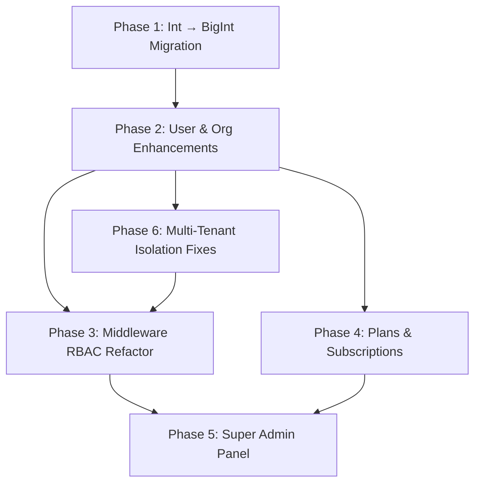

# NexBill → SaaS Transformation — Implementation Plan

> **Scope**: Convert the existing single-tenant NexBill billing application into a full multi-tenant SaaS platform with organisation management, granular employee access control, subscription billing, and a separate Super Admin panel — all sharing one database.
>
> **Created**: 2026-10-22
> **Status**: Draft — Under Review
> **Last Updated**: 2026-10-22

---

## Table of Contents

- [Current State Analysis](#-current-state-analysis)
- [Phase 1: Int → BigInt Migration](#phase-1-int--bigint-migration-foundation)
- [Phase 2: User & Organisation Management](#phase-2-enhanced-user--organisation-management)
- [Phase 3: Middleware & Backend Refactoring](#phase-3-middleware--backend-refactoring)
- [Phase 4: Subscription & Billing System](#phase-4-subscription--billing-system)
- [Phase 5: Super Admin Panel](#phase-5-super-admin-panel-separate-project)
- [Phase 6: Multi-Tenant Data Isolation Fixes](#phase-6-multi-tenant-data-isolation-fixes)
- [New DB Schema Summary](#-complete-new-db-schema-summary)
- [ER Diagram](#-entity-relationship-diagram-new-additions)
- [Execution Order](#-execution-order--dependencies)
- [Risk Considerations](#-risk-considerations)

---

## 📊 Current State Analysis

### What Exists Today

| Layer | Current State |
|---|---|
| **DB** | MySQL/MariaDB via Prisma + `@prisma/adapter-mariadb`. **35 models**, all PKs and FKs are `Int` |
| **Multi-tenancy** | Partial — `Business` model acts as tenant, `BusinessMember` links users. Every data table has `businessId` FK |
| **Auth** | JWT-based (`User` → `UserRole` → `Role` → `RolePermission` → `Permission`). Only 2 roles seeded: `ADMIN`, `USER` |
| **Business RBAC** | `BusinessRole` enum: `OWNER / ADMIN / STAFF` — stored on `BusinessMember`, but **never enforced in middleware** |
| **Middleware chain** | `authenticate → extractBusiness → [route handler]`. The `extractBusiness` validates membership but does NOT check the member's `BusinessRole` |
| **Frontend** | React + Vite + Zustand stores. Sends `x-business-id` header. Uses `sessionStorage` for token/user/businessId |
| **Super Admin** | Does not exist |
| **Subscriptions/Billing** | Does not exist |
| **Employee invite flow** | Does not exist |

### Key Gaps Identified

1. **No per-organisation permission system** — `BusinessRole` enum is stored but ignored by the authorize middleware
2. **No granular feature-level access** — STAFF can do everything an OWNER can
3. **No subscription/plan/payment tracking** — no concept of what an org is paying for
4. **No Super Admin model** — no way for the platform operator to manage orgs
5. **All IDs are `Int`** — not safe for scale (max 2.1B rows per table)
6. **`parseInt()` used for businessId parsing** — will break for BigInt values
7. **Invoice numbers use `@unique` globally** — should be `@@unique([businessId, invoiceNo])` for multi-tenant isolation
8. **No soft-delete / account suspension model** — can't disable an org without deleting data
9. **No user status field** — can't deactivate individual employees

---

## Phase 1: Int → BigInt Migration (Foundation)

> **Why first**: Every subsequent phase adds new tables/columns. Doing the type change after would require re-migrating everything.

### 1.1 Schema Changes — Every `Int` PK/FK → `BigInt`

In Prisma, this means changing `Int` to `BigInt` across **all 35 models**. Example:

```diff
 model User {
-  id              Int              @id @default(autoincrement())
+  id              BigInt           @id @default(autoincrement())
   ...
 }

 model UserRole {
-  userId    Int
-  roleId    Int
+  userId    BigInt
+  roleId    BigInt
   ...
 }
```

**Affected tables** (all 35 models in `prisma/schema.prisma`):

| Model | Fields to change |
|---|---|
| `User` | `id` |
| `Role` | `id` |
| `Permission` | `id` |
| `UserRole` | `userId`, `roleId` |
| `RolePermission` | `roleId`, `permissionId` |
| `Business` | `id` (keep `numbering*Next` fields as Int — they are counters not IDs) |
| `BusinessMember` | `id`, `businessId`, `userId` |
| `Party` | `id`, `businessId` |
| `Category` | `id`, `businessId`, `parentCategoryId` |
| `Unit` | `id`, `businessId`, `secondaryUnitId` |
| `Item` | `id`, `businessId`, `categoryId`, `unitId` |
| `StockLedger` | `id`, `businessId`, `itemId`, `referenceId` |
| `BomComponent` | `id`, `finishedGoodId`, `rawMaterialId` |
| `ManufacturingOrder` | `id`, `businessId`, `finishedGoodId` |
| `SalesInvoice` | `id`, `businessId`, `partyId` |
| `SalesInvoiceRow` | `id`, `invoiceId`, `itemId`, `box` |
| `Estimate` | `id`, `businessId`, `partyId`, `convertedInvoiceId` |
| `EstimateRow` | `id`, `estimateId`, `itemId`, `box` |
| `PaymentIn` | `id`, `businessId`, `partyId`, `bankAccountId`, `purchaseReturnId` |
| `PaymentInAllocation` | `id`, `paymentInId`, `invoiceId` |
| `PaymentOut` | `id`, `businessId`, `partyId`, `bankAccountId`, `salesReturnId` |
| `PaymentOutAllocation` | `id`, `paymentOutId`, `purchaseInvoiceId` |
| `SalesReturn` | `id`, `businessId`, `partyId`, `originalInvoiceId` |
| `SalesReturnRow` | `id`, `salesReturnId`, `itemId`, `box` |
| `DeliveryChallan` | `id`, `businessId`, `partyId`, `convertedInvoiceId` |
| `DeliveryChallanRow` | `id`, `deliveryChallanId`, `itemId`, `box` |
| `SalesOrder` | `id`, `businessId`, `partyId`, `convertedInvoiceId` |
| `SalesOrderRow` | `id`, `salesOrderId`, `itemId`, `box` |
| `PurchaseInvoice` | `id`, `businessId`, `partyId` |
| `PurchaseInvoiceRow` | `id`, `purchaseInvoiceId`, `itemId`, `box` |
| `BankAccount` | `id`, `businessId` |
| `BankingTransaction` | `id`, `businessId`, `bankAccountId` |
| `Expense` | `id`, `businessId` |
| `Discount` | `id`, `businessId` |
| `File` | `id`, `businessId`, `referenceId`, `sizeBytes` |
| `DocumentAuditLog` | `id`, `businessId`, `documentId`, `userId` |
| `PurchaseReturn` | `id`, `businessId`, `partyId`, `originalBillId` |
| `PurchaseReturnRow` | `id`, `purchaseReturnId`, `itemId`, `box` |

### 1.2 Backend Code Changes for BigInt

| File(s) | Change Required |
|---|---|
| `src/middlewares/extractBusiness.js` (line 15) | `parseInt()` → `BigInt()` for `businessId` parsing |
| All controllers / services | Any `parseInt(req.params.id)` or `Number(id)` → use `BigInt()` or let Prisma handle coercion |
| `prisma/seed.js` | Hardcoded `id: 1, id: 2` → use `BigInt(1)` etc. |
| JSON serialization | `BigInt` can't be serialized by `JSON.stringify` by default — add a global serializer: `BigInt.prototype.toJSON = function() { return this.toString(); }` in `src/app.js` |
| Frontend `authStore.js` | `parseInt(businessId, 10)` → just store as string, compare as string |

### 1.3 Frontend Changes

| File | Change |
|---|---|
| `stores/authStore.js` (line 21) | Remove `parseInt(businessId, 10)` — store businessId as a string |
| `lib/axios.js` (line 93-96) | `x-business-id` header already sent as string ✅ |
| All stores | Ensure ID comparisons use `===` on strings, not `===` on numbers |

### 1.4 Migration Strategy

```bash
# 1. Backup production DB
# 2. Generate migration
npx prisma migrate dev --name int-to-bigint
# 3. Prisma will generate ALTER TABLE statements to change column types
# 4. Test thoroughly — BigInt FK relationships must all align
```

> ⚠️ **CAUTION**: This migration on a large production DB with existing data will lock tables during ALTER. Schedule during maintenance window. For very large tables, consider using `pt-online-schema-change` or similar tool.

### 1.5 Checklist

- [ ] Update all 35 models in `schema.prisma` (Int → BigInt)
- [ ] Update `extractBusiness.js` — replace `parseInt()` with `BigInt()`
- [ ] Add `BigInt.prototype.toJSON` serializer in `app.js`
- [ ] Update `seed.js` to use BigInt values
- [ ] Update all `parseInt()` calls in controllers/services
- [ ] Update frontend `authStore.js` — remove parseInt for businessId
- [ ] Run migration: `npx prisma migrate dev --name int-to-bigint`
- [ ] Run full test suite
- [ ] Verify all API responses serialize BigInt correctly

---

## Phase 2: Enhanced User & Organisation Management

### 2.1 New/Modified Schema — User Management

```prisma
// Add status + metadata to User
model User {
  id              BigInt           @id @default(autoincrement())
  name            String?
  email           String           @unique
  password        String
  phone           String?                    // NEW
  avatarUrl       String?                    // NEW
  isActive        Boolean          @default(true)  // NEW — for deactivation
  lastLoginAt     DateTime?                  // NEW
  createdAt       DateTime         @default(now())
  updatedAt       DateTime         @updatedAt
  
  userRoles       UserRole[]
  businessMembers BusinessMember[]
  documentAuditLogs DocumentAuditLog[]

  @@map("users")
}
```

### 2.2 New/Modified Schema — Organisation (Business) Enhancement

```prisma
model Business {
  id                         BigInt   @id @default(autoincrement())
  name                       String
  // ... all existing fields ...
  
  // NEW: SaaS fields
  slug                       String?  @unique        // URL-friendly identifier
  isActive                   Boolean  @default(true)  // Platform can suspend
  suspendedAt                DateTime?                // When suspended
  suspendedReason            String?                  // Why suspended
  maxMembers                 Int      @default(5)     // Plan limit
  planId                     BigInt?                  // FK to subscription plan
  subscriptionStatus         SubscriptionStatus @default(TRIAL)
  trialEndsAt                DateTime?
  
  // ... all existing relations ...
  plan                       Plan?    @relation(fields: [planId], references: [id])
  subscription               Subscription?
  
  @@map("businesses")
}

enum SubscriptionStatus {
  TRIAL
  ACTIVE
  PAST_DUE
  CANCELLED
  SUSPENDED
}
```

### 2.3 New Schema — Employee Access Control (Per-Organisation)

```prisma
model BusinessMember {
  id                BigInt       @id @default(autoincrement())
  businessId        BigInt
  userId            BigInt
  role              BusinessRole
  isActive          Boolean      @default(true)   // NEW
  invitedAt         DateTime?                      // NEW
  joinedAt          DateTime?                      // NEW
  invitedByMemberId BigInt?                        // NEW
  
  createdAt         DateTime     @default(now())
  updatedAt         DateTime     @updatedAt
  
  business          Business     @relation(fields: [businessId], references: [id], onDelete: Cascade)
  user              User         @relation(fields: [userId], references: [id], onDelete: Cascade)
  invitedBy         BusinessMember? @relation("InviteChain", fields: [invitedByMemberId], references: [id])
  invitees          BusinessMember[] @relation("InviteChain")
  memberPermissions BusinessMemberPermission[]     // NEW

  @@unique([businessId, userId])  // NEW — prevent duplicate memberships
  @@map("business_members")
}

// NEW: Granular per-member permissions within a business
model BusinessPermission {
  id          BigInt   @id @default(autoincrement())
  code        String   @unique    // e.g. "sales:create", "inventory:delete", "reports:view"
  module      String              // e.g. "sales", "inventory", "purchase", "banking"
  name        String              // Human-readable name
  description String?
  createdAt   DateTime @default(now())

  memberPermissions BusinessMemberPermission[]

  @@map("business_permissions")
}

// NEW: Junction — which member has which business permission
model BusinessMemberPermission {
  memberId     BigInt
  permissionId BigInt
  grantedAt    DateTime @default(now())

  member     BusinessMember     @relation(fields: [memberId], references: [id], onDelete: Cascade)
  permission BusinessPermission @relation(fields: [permissionId], references: [id], onDelete: Cascade)

  @@id([memberId, permissionId])
  @@map("business_member_permissions")
}
```

### 2.4 Predefined Business Permissions to Seed

```
Module          Permission Code           Description
─────────────────────────────────────────────────────────────────
dashboard       dashboard:view            View dashboard
sales           sales:view                View sales invoices
sales           sales:create              Create/edit sales invoices
sales           sales:delete              Delete sales invoices
sales           estimates:manage          Manage estimates
sales           orders:manage             Manage sales orders
sales           challans:manage           Manage delivery challans
sales           returns:manage            Manage sales returns
sales           payment_in:manage         Manage payments received
purchase        purchase:view             View purchase invoices
purchase        purchase:create           Create/edit purchases
purchase        purchase:delete           Delete purchases
purchase        purchase:returns:manage   Manage purchase returns
purchase        payment_out:manage        Manage payments made
inventory       inventory:view            View items & stock
inventory       inventory:create          Create/edit items
inventory       inventory:delete          Delete/archive items
inventory       manufacturing:manage      Manage manufacturing orders
parties         parties:view              View parties
parties         parties:create            Create/edit parties
parties         parties:delete            Delete/archive parties
banking         banking:view              View bank accounts
banking         banking:manage            Manage bank accounts & transactions
expenses        expenses:view             View expenses
expenses        expenses:manage           Create/edit/delete expenses
reports         reports:view              View all reports
settings        settings:view             View business settings
settings        settings:manage           Modify business settings
members         members:view              View team members
members         members:invite            Invite new members
members         members:manage            Change roles & permissions
backup          backup:manage             Create/restore backups
```

> **Permission Rules:**
> - `OWNER` gets all permissions implicitly (no rows needed).
> - `ADMIN` gets all except `members:manage` and `settings:manage` by default.
> - `STAFF` gets only explicitly granted permissions.

### 2.5 Checklist

- [ ] Add new columns to `User` model (phone, avatarUrl, isActive, lastLoginAt)
- [ ] Add SaaS fields to `Business` model (slug, isActive, suspendedAt, etc.)
- [ ] Add new fields to `BusinessMember` (isActive, invitedAt, joinedAt, invitedByMemberId)
- [ ] Add `@@unique([businessId, userId])` to `BusinessMember`
- [ ] Create `BusinessPermission` model
- [ ] Create `BusinessMemberPermission` junction model
- [ ] Create seed file for the 32 business permissions
- [ ] Build employee invite API endpoints
- [ ] Build employee deactivation API endpoints
- [ ] Update auth service to return member permissions
- [ ] Run migration

---

## Phase 3: Middleware & Backend Refactoring

### 3.1 New Middleware: `authorizeBusinessAction`

```javascript
// middlewares/authorizeBusinessAction.js
const authorizeBusinessAction = (...requiredPermissions) => {
  return async (req, _res, next) => {
    const member = req.businessMember;
    
    // OWNER bypasses all checks
    if (member.role === 'OWNER') return next();
    
    // ADMIN has all permissions except member/settings management
    if (member.role === 'ADMIN') {
      const adminRestricted = ['members:manage', 'settings:manage'];
      const needsRestricted = requiredPermissions.some(p => adminRestricted.includes(p));
      if (!needsRestricted) return next();
    }
    
    // For STAFF (and ADMIN needing restricted perms), check explicit grants
    const memberPerms = await prisma.businessMemberPermission.findMany({
      where: { memberId: member.id },
      include: { permission: true },
    });
    
    const permCodes = memberPerms.map(mp => mp.permission.code);
    const hasAll = requiredPermissions.every(p => permCodes.includes(p));
    
    if (!hasAll) {
      return next(new ApiError(403, 'You do not have permission for this action'));
    }
    
    next();
  };
};
```

### 3.2 Updated Middleware Chain

```
Current:  authenticate → extractBusiness → handler
New:      authenticate → extractBusiness → authorizeBusinessAction('sales:create') → handler
```

### 3.3 Updated Route Examples

```javascript
// Before
router.post('/invoices', authenticate, extractBusiness, createInvoice);

// After
router.post('/invoices', authenticate, extractBusiness, authorizeBusinessAction('sales:create'), createInvoice);
```

### 3.4 Route-to-Permission Mapping

| Route File | Endpoints | Required Permission(s) |
|---|---|---|
| `sales.routes.js` | GET invoices | `sales:view` |
| | POST invoices | `sales:create` |
| | DELETE invoices | `sales:delete` |
| | GET/POST estimates | `estimates:manage` |
| | GET/POST orders | `orders:manage` |
| | GET/POST challans | `challans:manage` |
| | GET/POST returns | `returns:manage` |
| | GET/POST payment-in | `payment_in:manage` |
| `purchase.routes.js` | GET purchases | `purchase:view` |
| | POST purchases | `purchase:create` |
| | DELETE purchases | `purchase:delete` |
| | POST payment-out | `payment_out:manage` |
| | POST returns | `purchase:returns:manage` |
| `inventory.routes.js` | GET items | `inventory:view` |
| | POST items | `inventory:create` |
| | DELETE items | `inventory:delete` |
| `party.routes.js` | GET parties | `parties:view` |
| | POST parties | `parties:create` |
| | DELETE parties | `parties:delete` |
| `banking.routes.js` | GET accounts | `banking:view` |
| | POST accounts | `banking:manage` |
| `expense.routes.js` | GET expenses | `expenses:view` |
| | POST expenses | `expenses:manage` |
| `report.routes.js` | ALL | `reports:view` |
| `business.routes.js` | GET settings | `settings:view` |
| | PUT settings | `settings:manage` |
| `backup.routes.js` | ALL | `backup:manage` |
| `manufacturing.routes.js` | ALL | `manufacturing:manage` |

### 3.5 Checklist

- [ ] Create `authorizeBusinessAction` middleware
- [ ] Update `extractBusiness` to eagerly load member permissions
- [ ] Apply permission checks to all sales routes
- [ ] Apply permission checks to all purchase routes
- [ ] Apply permission checks to all inventory routes
- [ ] Apply permission checks to all party routes
- [ ] Apply permission checks to all banking routes
- [ ] Apply permission checks to all expense routes
- [ ] Apply permission checks to all report routes
- [ ] Apply permission checks to all settings routes
- [ ] Apply permission checks to all backup routes
- [ ] Apply permission checks to manufacturing routes
- [ ] Update frontend to show/hide UI based on user permissions
- [ ] Write tests for each permission gate

---

## Phase 4: Subscription & Billing System

### 4.1 New Schema — Plans & Subscriptions

```prisma
model Plan {
  id            BigInt   @id @default(autoincrement())
  name          String   @unique    // "Free", "Starter", "Pro", "Enterprise"
  code          String   @unique    // "free", "starter", "pro", "enterprise"
  description   String?  @db.Text
  priceMonthly  Decimal  @db.Decimal(12, 2)
  priceYearly   Decimal  @db.Decimal(12, 2)
  maxMembers    Int      @default(1)
  maxItems      Int      @default(100)
  maxInvoices   Int      @default(50)       // per month
  maxStorage    Int      @default(100)      // MB
  features      Json?                       // Feature flags JSON
  isActive      Boolean  @default(true)
  sortOrder     Int      @default(0)
  createdAt     DateTime @default(now())
  updatedAt     DateTime @updatedAt

  businesses    Business[]
  subscriptions Subscription[]

  @@map("plans")
}

model Subscription {
  id              BigInt             @id @default(autoincrement())
  businessId      BigInt             @unique
  planId          BigInt
  status          SubscriptionStatus @default(TRIAL)
  billingCycle    BillingCycle       @default(MONTHLY)
  currentPeriodStart DateTime
  currentPeriodEnd   DateTime
  cancelledAt     DateTime?
  createdAt       DateTime           @default(now())
  updatedAt       DateTime           @updatedAt

  business        Business           @relation(fields: [businessId], references: [id], onDelete: Cascade)
  plan            Plan               @relation(fields: [planId], references: [id])
  payments        SubscriptionPayment[]

  @@map("subscriptions")
}

enum BillingCycle {
  MONTHLY
  YEARLY
}

model SubscriptionPayment {
  id              BigInt        @id @default(autoincrement())
  subscriptionId  BigInt
  amount          Decimal       @db.Decimal(12, 2)
  currency        String        @default("INR")
  status          PaymentStatus @default(PENDING)
  paymentMethod   String?
  transactionId   String?       // External payment gateway reference
  invoiceUrl      String?
  paidAt          DateTime?
  failedAt        DateTime?
  failureReason   String?
  periodStart     DateTime
  periodEnd       DateTime
  createdAt       DateTime      @default(now())

  subscription    Subscription  @relation(fields: [subscriptionId], references: [id], onDelete: Cascade)

  @@map("subscription_payments")
}

enum PaymentStatus {
  PENDING
  SUCCESS
  FAILED
  REFUNDED
}
```

### 4.2 Plan Enforcement Middleware

```javascript
// middlewares/enforcePlanLimits.js
const enforcePlanLimits = (resourceType) => {
  return async (req, _res, next) => {
    const business = await prisma.business.findUnique({
      where: { id: req.businessId },
      include: { plan: true, subscription: true },
    });
    
    if (business.subscriptionStatus === 'SUSPENDED' || business.subscriptionStatus === 'CANCELLED') {
      return next(new ApiError(403, 'Your subscription is inactive. Please renew.'));
    }
    
    if (business.subscriptionStatus === 'TRIAL' && business.trialEndsAt < new Date()) {
      return next(new ApiError(403, 'Your trial has expired. Please subscribe.'));
    }
    
    if (business.plan) {
      switch(resourceType) {
        case 'member': /* check maxMembers */ break;
        case 'item': /* check maxItems */ break;
        case 'invoice': /* check maxInvoices per month */ break;
      }
    }
    
    next();
  };
};
```

### 4.3 Checklist

- [ ] Create `Plan` model
- [ ] Create `Subscription` model
- [ ] Create `SubscriptionPayment` model
- [ ] Create enums: `BillingCycle`, `PaymentStatus`
- [ ] Seed default plans (Free, Starter, Pro, Enterprise)
- [ ] Create `enforcePlanLimits` middleware
- [ ] Apply plan limits to member invite endpoint
- [ ] Apply plan limits to item creation
- [ ] Apply plan limits to invoice creation
- [ ] Build plan management API (for super admin)
- [ ] Build subscription management API
- [ ] Integrate payment gateway (Razorpay/Stripe)
- [ ] Run migration

---

## Phase 5: Super Admin Panel (Separate Project)

### 5.1 Architecture

```
nexbill/
├── nexbill_backend/       ← Existing API (tenant-facing)
├── nexbill_frontend/      ← Existing UI (tenant-facing)
├── nexbill_admin/         ← NEW: Super Admin panel
│   ├── admin_backend/     ← Separate Express app, SAME DATABASE
│   └── admin_frontend/    ← Separate React/Vite app
```

**Key Principle**: Both `nexbill_backend` and `admin_backend` connect to the **same MariaDB database** using the **same Prisma schema** (shared as a package or duplicated). They are separate deployments with separate auth.

### 5.2 New Schema — Super Admin Auth

```prisma
model SuperAdmin {
  id        BigInt   @id @default(autoincrement())
  name      String
  email     String   @unique
  password  String
  role      SuperAdminRole @default(SUPPORT)
  isActive  Boolean  @default(true)
  lastLoginAt DateTime?
  createdAt DateTime @default(now())
  updatedAt DateTime @updatedAt

  auditLogs SuperAdminAuditLog[]

  @@map("super_admins")
}

enum SuperAdminRole {
  SUPER_ADMIN    // Full access
  ADMIN          // Can manage orgs, view billing, but can't create other admins
  SUPPORT        // Read-only access, can view org data for support
}

model SuperAdminAuditLog {
  id          BigInt   @id @default(autoincrement())
  adminId     BigInt
  action      String          // "suspend_business", "change_plan", "view_data"
  targetType  String?         // "business", "user", "subscription"
  targetId    BigInt?
  details     Json?
  ipAddress   String?
  createdAt   DateTime @default(now())

  admin       SuperAdmin @relation(fields: [adminId], references: [id])

  @@map("super_admin_audit_logs")
}
```

### 5.3 Super Admin Panel Features

| Module | What It Does |
|---|---|
| **Dashboard** | Total orgs, active users, MRR, trial conversions, growth charts |
| **Organisations** | List all businesses, search, filter by status/plan. View details, suspend/activate, force password reset |
| **Organisation Detail** | View business profile, member list, transaction volume, storage usage. Impersonate (read-only) |
| **Employee Access** | View/modify business members across any org. Force deactivate compromised accounts |
| **Subscriptions** | View all subscriptions, payment history, manually extend trials, change plans |
| **Plans** | CRUD for subscription plans (pricing, limits, features) |
| **Payments** | Payment ledger across all orgs, failed payments, refund processing |
| **Platform Users** | All registered users across all orgs, search by email, view multi-org membership |
| **Audit Logs** | All super admin actions. All `DocumentAuditLog` entries across orgs |
| **Settings** | Platform-level settings (default trial days, email templates, feature flags) |

### 5.4 Super Admin API Routes

```
POST   /admin/auth/login
GET    /admin/dashboard/stats
GET    /admin/organisations
GET    /admin/organisations/:id
PATCH  /admin/organisations/:id/suspend
PATCH  /admin/organisations/:id/activate
GET    /admin/organisations/:id/members
PATCH  /admin/organisations/:id/members/:memberId
GET    /admin/organisations/:id/subscription
PATCH  /admin/organisations/:id/subscription
GET    /admin/users
GET    /admin/users/:id
PATCH  /admin/users/:id/deactivate
GET    /admin/plans
POST   /admin/plans
PATCH  /admin/plans/:id
GET    /admin/subscriptions
GET    /admin/payments
POST   /admin/payments/:id/refund
GET    /admin/audit-logs
```

### 5.5 Super Admin Auth (Separate JWT)

```javascript
// admin_backend uses a DIFFERENT JWT_SECRET (e.g., ADMIN_JWT_SECRET)
// Token payload includes: { adminId, role: 'SUPER_ADMIN' }
// This ensures tenant tokens can NEVER access admin APIs and vice versa
```

### 5.6 Checklist

- [ ] Create `nexbill_admin/` directory structure
- [ ] Initialize admin_backend (Express app)
- [ ] Initialize admin_frontend (Vite + React)
- [ ] Create `SuperAdmin` model
- [ ] Create `SuperAdminAuditLog` model
- [ ] Share Prisma schema between projects
- [ ] Build admin auth (login, separate JWT)
- [ ] Build dashboard stats API
- [ ] Build organisation CRUD API
- [ ] Build org suspend/activate API
- [ ] Build member management API
- [ ] Build subscription management API
- [ ] Build plan CRUD API
- [ ] Build payment ledger API
- [ ] Build audit log viewer API
- [ ] Build admin frontend UI
- [ ] Run migration

---

## Phase 6: Multi-Tenant Data Isolation Fixes

### 6.1 Unique Constraints — Fix Global Uniqueness

Currently, document numbers like `invoiceNo`, `billNo`, etc. are `@unique` globally. Two different businesses should be able to have `INV-1`.

```diff
 model SalesInvoice {
-  invoiceNo  String  @unique
+  invoiceNo  String
   ...
+  @@unique([businessId, invoiceNo])
 }
```

**All document number fields to fix:**

| Model | Field | Current | New |
|---|---|---|---|
| `SalesInvoice` | `invoiceNo` | `@unique` | `@@unique([businessId, invoiceNo])` |
| `Estimate` | `estimateNo` | `@unique` | `@@unique([businessId, estimateNo])` |
| `PaymentIn` | `receiptNo` | `@unique` | `@@unique([businessId, receiptNo])` |
| `PaymentOut` | `paymentNo` | `@unique` | `@@unique([businessId, paymentNo])` |
| `SalesReturn` | `returnNo` | `@unique` | `@@unique([businessId, returnNo])` |
| `DeliveryChallan` | `challanNo` | `@unique` | `@@unique([businessId, challanNo])` |
| `SalesOrder` | `orderNo` | `@unique` | `@@unique([businessId, orderNo])` |
| `PurchaseInvoice` | `billNo` | `@unique` | `@@unique([businessId, billNo])` |
| `PurchaseReturn` | `returnNo` | `@unique` | `@@unique([businessId, returnNo])` |

### 6.2 Checklist

- [ ] Fix all 9 document number unique constraints
- [ ] Update Prisma queries that rely on `findUnique` with these fields
- [ ] Run migration
- [ ] Verify no existing data violates new constraints

---

## 📋 Complete New DB Schema Summary

### New Tables (7)

| Table | Purpose |
|---|---|
| `business_permissions` | Granular permission definitions for org members |
| `business_member_permissions` | Junction: member ↔ permission grants |
| `plans` | Subscription plan definitions |
| `subscriptions` | Active subscription per business |
| `subscription_payments` | Payment history |
| `super_admins` | Platform operator accounts |
| `super_admin_audit_logs` | Admin action audit trail |

### Modified Tables (4)

| Table | Changes |
|---|---|
| `users` | +`phone`, +`avatarUrl`, +`isActive`, +`lastLoginAt` |
| `businesses` | +`slug`, +`isActive`, +`suspendedAt`, +`suspendedReason`, +`maxMembers`, +`planId`, +`subscriptionStatus`, +`trialEndsAt` |
| `business_members` | +`isActive`, +`invitedAt`, +`joinedAt`, +`invitedByMemberId`, +`@@unique([businessId, userId])` |
| All 35 tables | `Int` → `BigInt` for all PKs and FKs |

### New Enums (4)

| Enum | Values |
|---|---|
| `SubscriptionStatus` | `TRIAL, ACTIVE, PAST_DUE, CANCELLED, SUSPENDED` |
| `BillingCycle` | `MONTHLY, YEARLY` |
| `PaymentStatus` | `PENDING, SUCCESS, FAILED, REFUNDED` |
| `SuperAdminRole` | `SUPER_ADMIN, ADMIN, SUPPORT` |

---

## 📐 Entity Relationship Diagram (New Additions)

```mermaid
erDiagram
    SuperAdmin {
        BigInt id PK
        String email UK
        SuperAdminRole role
    }
    SuperAdminAuditLog {
        BigInt id PK
        BigInt adminId FK
        String action
    }
    Plan {
        BigInt id PK
        String name UK
        Decimal priceMonthly
        Int maxMembers
    }
    Subscription {
        BigInt id PK
        BigInt businessId FK_UK
        BigInt planId FK
        SubscriptionStatus status
    }
    SubscriptionPayment {
        BigInt id PK
        BigInt subscriptionId FK
        Decimal amount
        PaymentStatus status
    }
    BusinessPermission {
        BigInt id PK
        String code UK
        String module
    }
    BusinessMemberPermission {
        BigInt memberId FK
        BigInt permissionId FK
    }

    SuperAdmin ||--o{ SuperAdminAuditLog : "logs"
    Plan ||--o{ Subscription : "has"
    Plan ||--o{ Business : "used_by"
    Business ||--o| Subscription : "subscribes"
    Subscription ||--o{ SubscriptionPayment : "payments"
    Business ||--o{ BusinessMember : "members"
    BusinessMember ||--o{ BusinessMemberPermission : "has"
    BusinessPermission ||--o{ BusinessMemberPermission : "granted_to"
    User ||--o{ BusinessMember : "belongs_to"
```

---

## 🔄 Execution Order & Dependencies



| Phase | Estimated Effort | Dependencies |
|---|---|---|
| Phase 1: BigInt | 2-3 days | None (do first) |
| Phase 2: User/Org | 3-4 days | Phase 1 |
| Phase 3: Middleware | 3-4 days | Phase 2 + Phase 6 |
| Phase 4: Subscriptions | 3-4 days | Phase 2 |
| Phase 5: Super Admin | 5-7 days | Phase 3 + Phase 4 |
| Phase 6: Isolation Fixes | 1-2 days | Phase 2 |
| **Total** | **~17-24 days** | |

---

## ⚠️ Risk Considerations

- **Data migration risk**: The Int→BigInt ALTER on large tables with foreign keys will lock tables. For tables with millions of rows, use online schema change tools.
- **JSON serialization**: JavaScript cannot natively `JSON.stringify(BigInt)`. You MUST add a serializer polyfill in the backend entry point, or convert to strings before sending API responses.
- **Shared Prisma schema**: Both the main backend and admin backend should use the same `schema.prisma` file. Consider extracting it into a shared npm package or using a symlink.
- **Feature flags**: The `Plan.features` JSON column allows you to gate features without schema changes. Example: `{ "manufacturing": true, "multiCurrency": false }`. Check these in middleware for feature-gating.

---

## 📝 Notes & Decisions Log

> Use this section to track decisions, changes to the plan, and open questions as you iterate.

| Date | Decision / Note |
|---|---|
| 2026-10-22 | Initial plan created |
| | |
| | |
